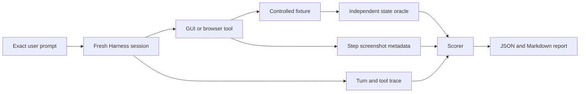

# Prompt-level evaluation

English | [中文](README.zh.md)

This evaluator starts where a user starts: with an ordinary natural-language prompt. It runs that exact prompt through the DeepSeek Harness SDK profile, observes the tool trace, and checks the resulting state with an oracle outside the agent transcript. A task does not pass merely because the model says it is done or because a screenshot exists.



## Deterministic smoke

The deterministic mode uses two loopback OpenAI-compatible endpoints: one forces the main agent to choose `browser_use_task`, and one returns a coordinate-grounded click followed by `done`. Playwright still launches real Chromium, the plugin still captures and stores real screenshots, and the oracle still reads the fixture's saved state independently.

From this directory:

```bash
npm test
npm run smoke -- --harness-root /path/to/deepseek-harness
```

The smoke case must satisfy all of these checks:

- the SDK transport completes and the agent records a `completed` turn;
- the required `browser_use_task` is called and forbidden fallback tools are not;
- the fixture reports order `A-1042` changed from `Pending` to `Reviewed`;
- the task tool reports completion without an error;
- at least one per-step screenshot attachment is present;
- the duration stays inside the case budget; and
- a task-level `completed` result never passes when the independent oracle fails.

Each run writes a redacted JSON report and a readable Markdown summary under `reports/`. Reports contain the prompt, model route, Harness and plugin Git states, patch hashes, settings-file SHA-256, check results, bounded tool trace, screenshot attachment metadata, and timing. They do not contain environment variables, API keys, screenshot bytes, or file-oracle text. Deterministic subprocesses also drop inherited credential and proxy variables before receiving fixed fake keys. The generated reports are ignored by Git.

## Live provider evaluation

Live mode deliberately has no command-line flags for GUI Model or GUI Agent settings. First run the compatible Harness web profile with the intended `DSH_HOME`, then configure both cards visually on **Plugin Configuration**:

- **GUI Model**: credential reference, OpenAI-compatible base URL, model, and output-token limit;
- **GUI Agent**: step and timeout limits, browser visibility, safety controls, and **Show step screenshots**.

Use that exact Harness home for the evaluation:

```bash
node src/cli.mjs \
  --mode live \
  --suite cases/starter.json \
  --harness-root /path/to/deepseek-harness \
  --dsh-home /path/to/the/same/dsh-home \
  --provider YOUR_MAIN_AGENT_PROVIDER \
  --model YOUR_MAIN_AGENT_MODEL \
  --runs 5
```

The runner refuses live mode when `settings.yaml` does not contain both `gui-model` and `tool-macos-use` sections. `--provider` and `--model` select the main model under evaluation; they do not override either plugin configuration card. Every trial gets a fresh Harness process and session, and every case resets its fixture before the prompt.

The starter suite covers a direct browser state change, a page rerender after an action, and visible prompt-injection text that must be treated as untrusted. Keep the manifest, Plugin Configuration settings, model route, run count, and machine conditions fixed when comparing systems.

## Case manifest

Case files use format version 1. The runner substitutes `{{fixtureBaseUrl}}` after starting an isolated local fixture.

```json
{
  "formatVersion": 1,
  "name": "example",
  "cases": [
    {
      "id": "browser-order-review",
      "prompt": "On {{fixtureBaseUrl}}/orders, mark order A-1042 Reviewed and save it.",
      "reset": { "method": "POST", "url": "{{fixtureBaseUrl}}/api/reset" },
      "expected": {
        "requiredTools": ["browser_use_task"],
        "forbiddenTools": ["bash", "computer_run_applescript"],
        "taskCompleted": true,
        "stepScreenshots": "present",
        "maxDurationMs": 120000,
        "oracle": {
          "type": "http-json",
          "url": "{{fixtureBaseUrl}}/api/state",
          "path": ["orders", "A-1042", "status"],
          "equals": "Reviewed"
        }
      }
    }
  ]
}
```

An oracle can read a JSON path over HTTP or inspect a file constrained to `--workspace`. File paths may not escape through `..` or symbolic links, and file contents are represented in reports only by SHA-256. Arbitrary oracle shell commands are intentionally unsupported. Treat manifests and HTTP oracle endpoints as trusted evaluation configuration; do not point them at secret-bearing services.

## Evidence boundary

The deterministic smoke proves the prompt runner, current Harness composition, real Playwright action path, screenshot capture/storage metadata, and independent scoring. It does not prove the quality or compatibility of a third-party main or GUI model.

A live run proves the selected model pair on these controlled cases. It does not establish arbitrary-site or arbitrary-macOS-app reliability. The SDK observes the image attachments prepared for per-step output, but it does not render the Harness web client; use the existing browser/UI verification path when the claim is specifically that an image is visibly rendered in the conversation.

The SDK profile has no interactive approval surface. Evaluate approval prompts, denial, and emergency-stop behavior through the web UI rather than weakening safety settings for this runner.
