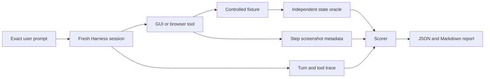

# Prompt-level evaluation

English | [中文](README.zh.md)

This evaluator starts where a user starts: with an ordinary natural-language prompt. It runs that exact prompt through the DeepSeek Harness SDK profile, observes the tool trace, and checks the resulting state with an oracle outside the agent transcript. A task does not pass merely because the model says it is done or because a screenshot exists.



## Deterministic smoke

The deterministic mode uses two loopback OpenAI-compatible endpoints: one forces the main agent to choose `browser_use_task`, and one returns a coordinate-grounded click followed by `done`. Playwright still launches real Chromium, the plugin still captures and stores real screenshots, and the oracle still reads the fixture's saved state independently. Because the SDK profile has no interactive approval answerer, this mode deliberately sets both `confirmDestructiveActions` and `confirmEveryMutation` to `false` only inside its isolated, fixed-action fixture. The fake providers, explicit loopback allowlist, stripped inherited credentials, reset fixture, and independent oracle form the trusted test boundary; do not copy those overrides into general automation. Production keeps both confirmation layers enabled by default and exercises them in separate tests.

From this directory:

```bash
npm test
npm run smoke -- --harness-root /path/to/deepseek-harness
```

The evaluator suite contains 19 tests across 8 files. The release gate runs them in an environment that permits loopback listeners, where all 19 pass, and then runs the deterministic prompt-to-browser smoke separately.

The smoke case must satisfy all of these checks:

- the SDK transport completes and the agent records a `completed` turn;
- the required `browser_use_task` is called and forbidden fallback tools are not;
- the fixture reports order `A-1042` changed from `Pending` to `Reviewed`;
- the task tool reports that its requested postcondition passed against a fresh, atomic host-side completion snapshot, not merely model-declared `done`;
- the task postcondition is present in the tool call and its verification status is `verified`;
- at least one per-step screenshot attachment is present;
- the duration stays inside the case budget; and
- a task-level `completed` result never passes when the independent oracle fails.

Each run writes a redacted JSON report and a readable Markdown summary under `reports/`. Reports contain the prompt, model route, Harness and plugin Git states, patch hashes, settings-file SHA-256, check results, bounded tool trace, screenshot attachment metadata, and timing. They do not contain environment variables, API keys, screenshot bytes, or file-oracle text. User-facing task history also replaces each `type` action's text with a character-count placeholder; this does not redact text visible inside screenshot pixels. Deterministic subprocesses drop inherited credential and proxy variables before receiving fixed fake keys. The generated reports are ignored by Git.

## Live provider evaluation

Live mode deliberately has no command-line flags for GUI Model or GUI Agent settings. First mount the four services in a compatible Harness checkout. From the Harness root:

```bash
plugin_root=/absolute/path/to/deepseek-harness-macos-use
export DSH_HOME="$(mktemp -d /private/tmp/dsh-macos-profile.XXXXXX)"
node apps/cli/lib/bin.js --profile web --patch "$plugin_root/integration/macos-use.cordis.patch.yml" --dump-config
node apps/cli/lib/bin.js --profile web --patch "$plugin_root/integration/macos-use.cordis.patch.yml"
```

The preflight must show `macos-use`, `browser-use`, `gui-model`, and `tool-macos-use`. The mount patch contains zero adjustable agent keys. With that exact `DSH_HOME`, configure both cards visually on **Plugin Configuration**:

- **GUI Model**: credential reference, OpenAI-compatible base URL, model, and output-token limit;
- **GUI Agent**: step and timeout limits, browser visibility, explicit browser-domain and macOS-app grants,
  safety controls, and **Show step screenshots**. **Confirm every GUI mutation** is on by default. Empty grants intentionally disable the corresponding capability.

Use that exact Harness home for the evaluation:

```bash
node src/cli.mjs \
  --mode live \
  --suite cases/starter.json \
  --harness-root /path/to/deepseek-harness \
  --dsh-home /path/to/the/same/dsh-home \
  --provider YOUR_MAIN_AGENT_PROVIDER \
  --model YOUR_MAIN_AGENT_MODEL \
  --runs 5
```

The runner refuses live mode when `settings.yaml` does not contain both `gui-model` and `tool-macos-use` sections. `--provider` and `--model` select the main model under evaluation; they do not override either plugin configuration card. Every trial gets a fresh Harness process and session, and every case resets its fixture before the prompt.

The starter suite covers a direct browser state change, a page rerender after an action, and visible prompt-injection text that must be treated as untrusted. Keep the manifest, Plugin Configuration settings, model route, run count, and machine conditions fixed when comparing systems.

## Case manifest

Case files use format version 1. The runner substitutes `{{fixtureBaseUrl}}` after starting an isolated local fixture.

```json
{
  "formatVersion": 1,
  "name": "example",
  "cases": [
    {
      "id": "browser-order-review",
      "prompt": "On {{fixtureBaseUrl}}/orders, mark order A-1042 Reviewed and save it.",
      "reset": { "method": "POST", "url": "{{fixtureBaseUrl}}/api/reset" },
      "expected": {
        "requiredTools": ["browser_use_task"],
        "forbiddenTools": ["bash", "computer_run_applescript"],
        "taskCompleted": true,
        "taskVerification": "verified",
        "stepScreenshots": "present",
        "maxDurationMs": 120000,
        "oracle": {
          "type": "http-json",
          "url": "{{fixtureBaseUrl}}/api/state",
          "path": ["orders", "A-1042", "status"],
          "equals": "Reviewed"
        }
      }
    }
  ]
}
```

An oracle can read a JSON path over HTTP or inspect a file constrained to `--workspace`. File paths may not escape through `..` or symbolic links, and file contents are represented in reports only by SHA-256. Arbitrary oracle shell commands are intentionally unsupported. Treat manifests and HTTP oracle endpoints as trusted evaluation configuration; do not point them at secret-bearing services.

## Evidence boundary

The deterministic smoke is designed to prove the prompt runner, current Harness composition, real Playwright action path, atomic task-postcondition verification, screenshot capture/storage metadata, and separate independent-oracle scoring when its complete gate runs. A model-selected postcondition alone is not proof of the full user outcome; the evaluator therefore requires its external oracle too. An uncertain or invalid provider action must stop the task and fail the case rather than being guessed. The smoke does not prove the quality or compatibility of a third-party main or GUI model.

A live run proves the selected model pair on these controlled cases. It does not establish arbitrary-site or arbitrary-macOS-app reliability. The SDK observes the image attachments prepared for per-step output, but it does not render the Harness web client; use the existing browser/UI verification path when the claim is specifically that an image is visibly rendered in the conversation.

The SDK profile has no interactive approval surface, so the production default makes every mutation fail closed there. Run a mutating SDK evaluation only behind an equivalent trusted safety or approval boundary; in this isolated fixed-action fixture, the operator deliberately turns both confirmation layers off. That exception is part of the trusted test boundary, not a recommended production setting and not a semantic-effect guarantee. Default approval, denial, emergency-stop, and inline-screenshot behavior are tested separately; the release workflow also renders the real configuration and task-output components in Chromium. Native action/capture E2E still requires a fresh, unlocked macOS session.
