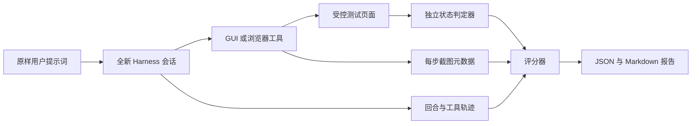

# 提示词级评测

[English](README.md) | 中文

本评测器从用户真正开始的地方出发：一条普通的自然语言提示词。它把这条原样提示词送入 DeepSeek Harness SDK profile，观察工具轨迹，并通过智能体对话之外的判定器检查最终状态。模型声称任务完成或存在截图，都不能单独让任务通过。



## 确定性冒烟测试

确定性模式使用两个环回、兼容 OpenAI 的端点：一个让主智能体固定选择 `browser_use_task`，另一个返回基于坐标的点击动作，然后返回 `done`。Playwright 仍会启动真实 Chromium，插件仍会捕获并保存真实截图，判定器也仍会独立读取测试页面保存的状态。

在本目录运行：

```bash
npm test
npm run smoke -- --harness-root /path/to/deepseek-harness
```

冒烟用例必须同时满足以下检查：

- SDK 传输完成，且智能体记录 `completed` 回合；
- 调用了要求的 `browser_use_task`，且没有使用禁止的后备工具；
- 测试页面报告订单 `A-1042` 从 `Pending` 变为 `Reviewed`；
- 任务工具无错误并报告完成；
- 至少存在一个每步截图附件；
- 耗时不超过用例预算；以及
- 当独立判定器失败时，任务级 `completed` 结果绝不会通过。

每次运行都会在 `reports/` 下写入脱敏 JSON 报告和便于阅读的 Markdown 摘要。报告包含提示词、模型路由、Harness 与插件 Git 状态、补丁哈希、设置文件 SHA-256、各项检查、受限工具轨迹、截图附件元数据和耗时；不包含环境变量、API 密钥、截图字节或文件判定器原文。确定性子进程还会先移除继承的凭据与代理变量，再接收固定的伪密钥。生成的报告已被 Git 忽略。

## 真实提供方评测

真实模式有意不提供覆盖 GUI 模型或 GUI 智能体设置的命令行参数。请先用目标 `DSH_HOME` 运行兼容的 Harness Web profile，再在**插件配置**页面中可视化配置两张卡：

- **GUI 模型**：凭据引用、兼容 OpenAI 的基础 URL、模型和输出 token 上限；
- **GUI 智能体**：步骤和超时限制、浏览器可见性、安全控制，以及**显示每步截图**。

评测时使用完全相同的 Harness home：

```bash
node src/cli.mjs \
  --mode live \
  --suite cases/starter.json \
  --harness-root /path/to/deepseek-harness \
  --dsh-home /path/to/the/same/dsh-home \
  --provider YOUR_MAIN_AGENT_PROVIDER \
  --model YOUR_MAIN_AGENT_MODEL \
  --runs 5
```

当 `settings.yaml` 不同时包含 `gui-model` 和 `tool-macos-use` 两个区块时，运行器会拒绝真实模式。`--provider` 和 `--model` 只选择被评测的主模型，不会覆盖任何插件配置卡。每个 trial 都使用全新的 Harness 进程和会话，每个用例都会在发送提示词前重置测试页面。

入门套件覆盖直接修改浏览器状态、操作后页面重新渲染，以及必须被视为不可信内容的可见提示词注入文本。比较不同系统时，应固定用例清单、插件配置设置、模型路由、运行次数和机器条件。

## 用例清单

用例文件使用格式版本 1。运行器启动隔离的本地测试页面后，会替换 `{{fixtureBaseUrl}}`。

```json
{
  "formatVersion": 1,
  "name": "example",
  "cases": [
    {
      "id": "browser-order-review",
      "prompt": "On {{fixtureBaseUrl}}/orders, mark order A-1042 Reviewed and save it.",
      "reset": { "method": "POST", "url": "{{fixtureBaseUrl}}/api/reset" },
      "expected": {
        "requiredTools": ["browser_use_task"],
        "forbiddenTools": ["bash", "computer_run_applescript"],
        "taskCompleted": true,
        "stepScreenshots": "present",
        "maxDurationMs": 120000,
        "oracle": {
          "type": "http-json",
          "url": "{{fixtureBaseUrl}}/api/state",
          "path": ["orders", "A-1042", "status"],
          "equals": "Reviewed"
        }
      }
    }
  ]
}
```

判定器可以通过 HTTP 读取 JSON 路径，也可以检查被限制在 `--workspace` 内的文件。文件路径不能通过 `..` 或符号链接逃逸，文件内容在报告中只以 SHA-256 表示。这里有意不支持任意判定器 shell 命令。请把清单和 HTTP 判定器端点视为可信评测配置，不要让它们指向含有秘密的服务。

## 证据边界

确定性冒烟测试证明了提示词运行器、当前 Harness 组合、真实 Playwright 操作路径、截图捕获／存储元数据和独立评分。它不证明第三方主模型或 GUI 模型的质量与兼容性。

真实运行证明所选模型组合在这些受控用例上的表现，不能建立对任意网站或任意 macOS 应用的可靠性结论。SDK 能观察为每步输出准备的图片附件，但不会渲染 Harness Web 客户端；当要证明图片确实在对话中可见时，应继续使用现有的浏览器／UI 验证路径。

SDK profile 没有交互式审批界面。请通过 Web UI 评测审批提示、拒绝和紧急停止行为，不要为了本运行器而降低安全设置。
